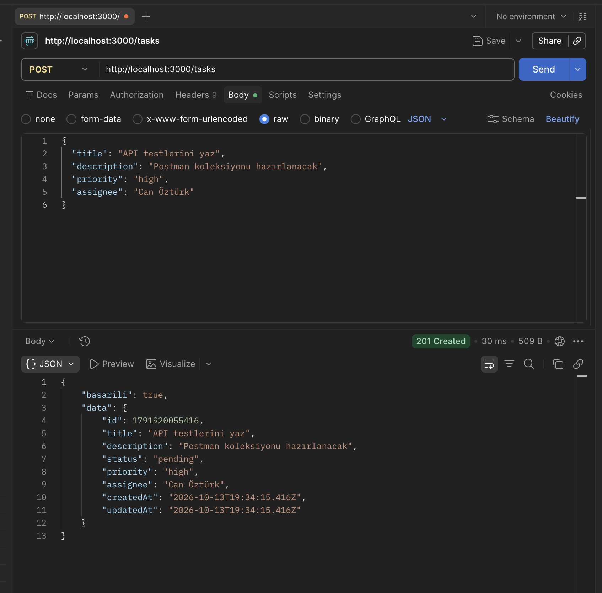
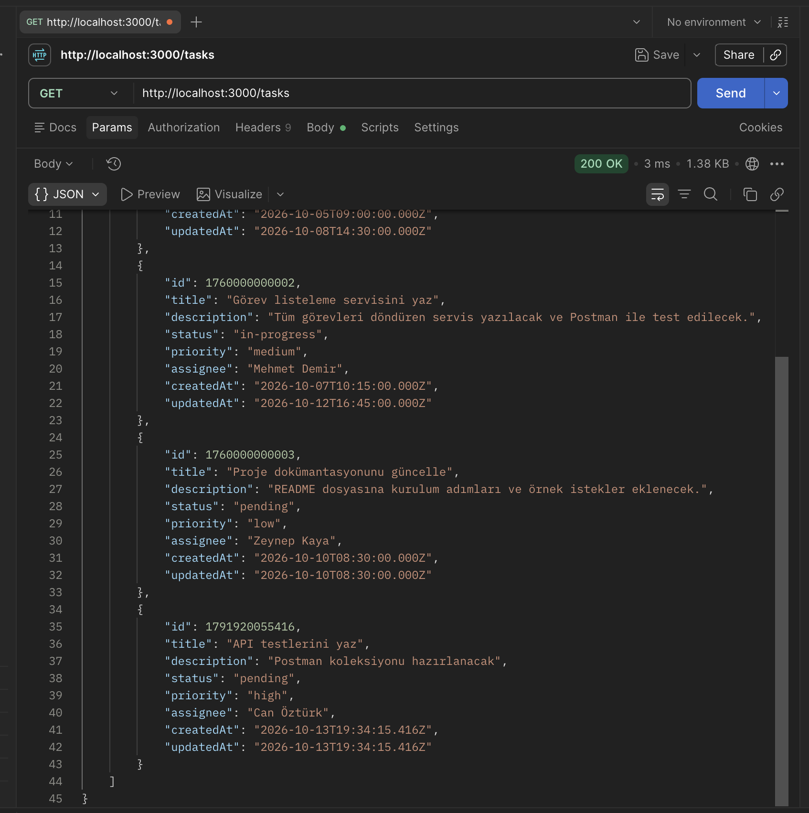
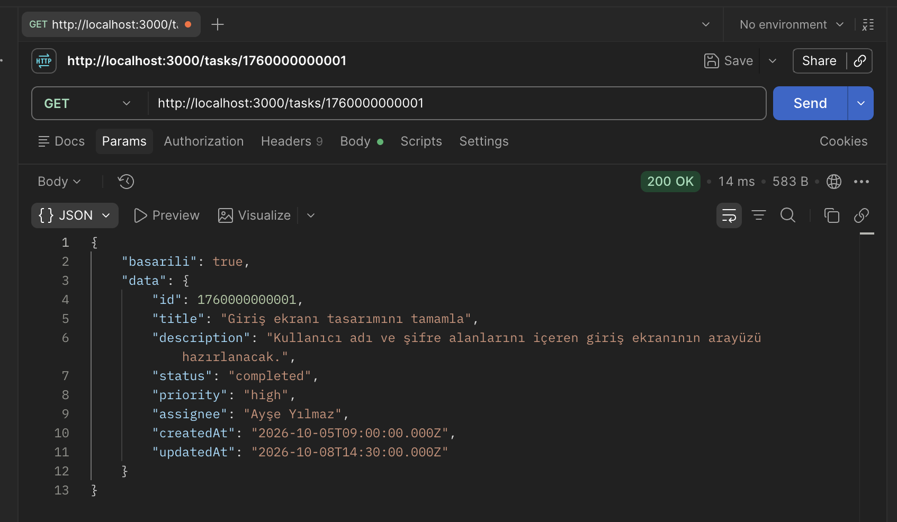
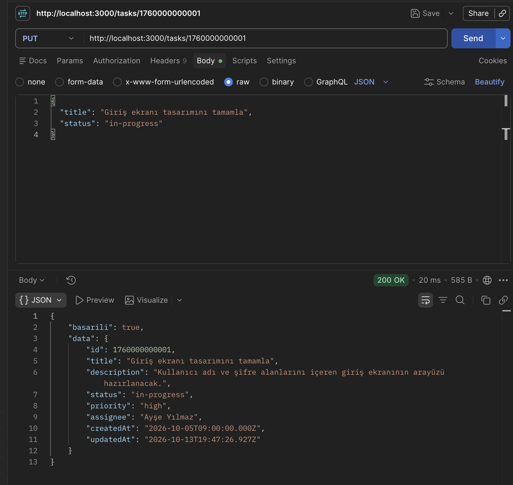
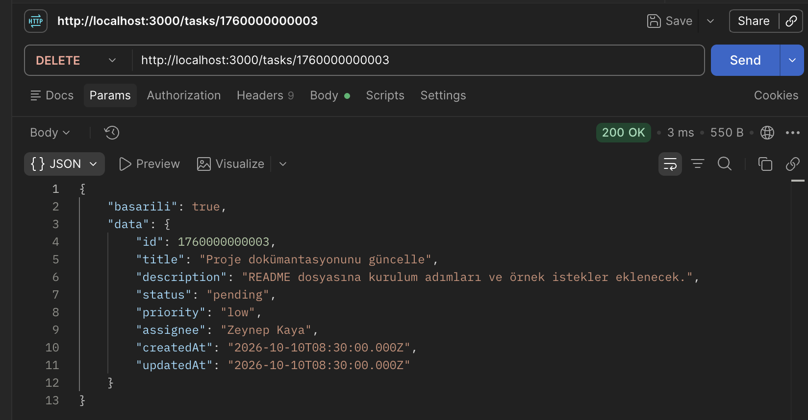
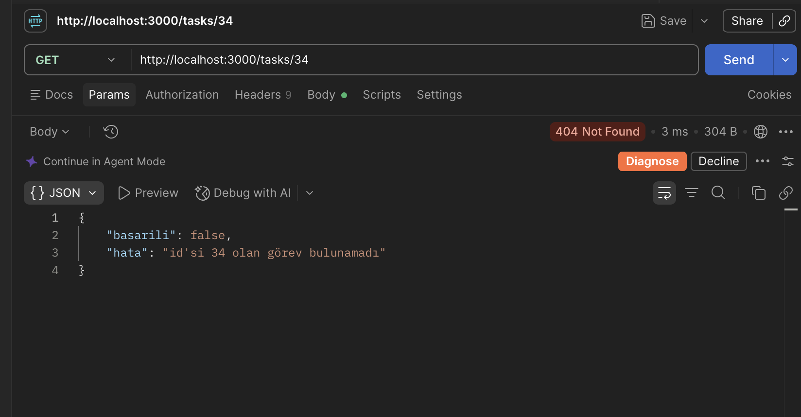
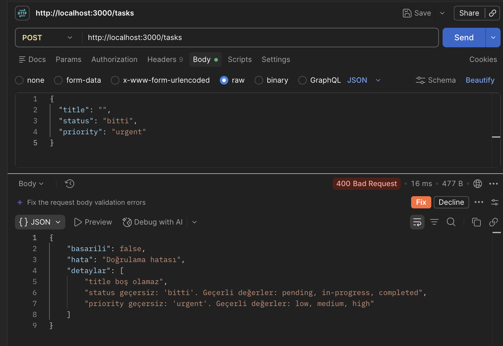
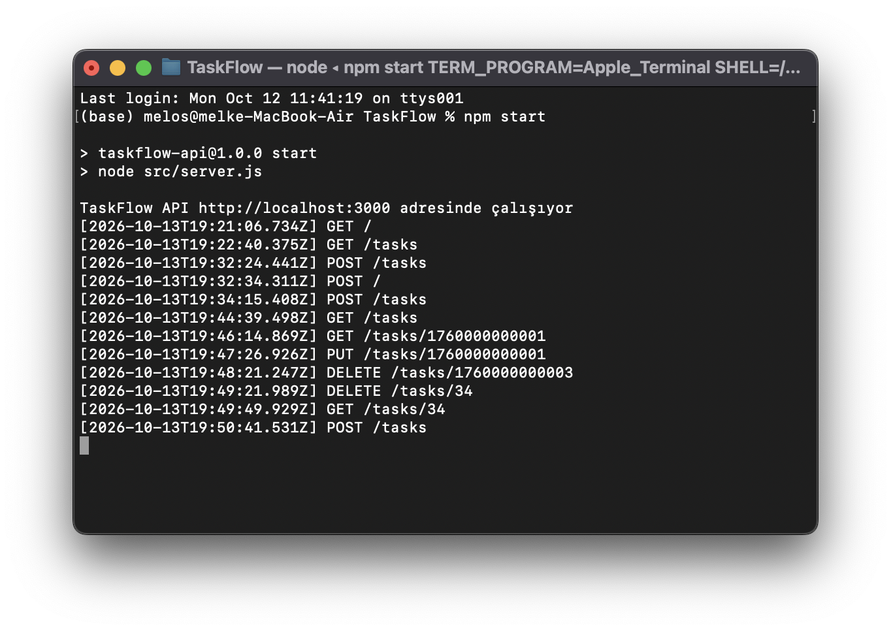
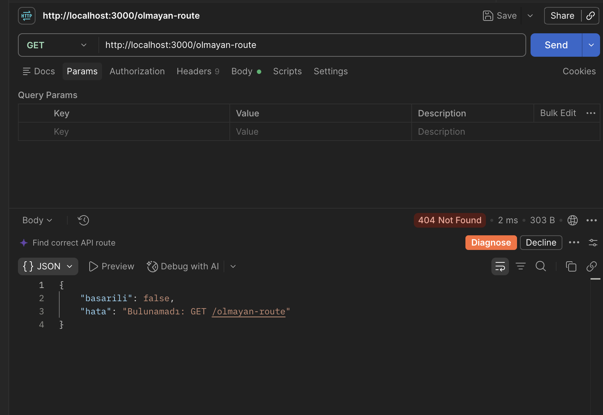

# TaskFlow API

TaskFlow, bir yazılım ekibinin görevlerini oluşturmasını, çalışanlara atamasını, durum ve öncelik takibi yapmasını sağlayan bir REST API'sidir. Node.js ve Express.js ile yazılmıştır; veriler bellekte bir dizide tutulur.

Bu proje "Node.js ile Backend Programlama" eğitiminin bitirme projesidir.

## Özellikler

- Görevler için tam CRUD: listeleme, detay, ekleme, güncelleme, silme
- `express.Router()` ile ayrı route dosyası
- Logger middleware'i: her isteğin zaman damgası, method ve URL'si konsola yazılır
- Doğrulama middleware'i: eksik veya geçersiz veride açıklayıcı mesajla 400 döner
- Tutarlı JSON yanıt biçimi ve Türkçe hata mesajları

## Gereksinimler

- Node.js 18 veya üzeri (proje Node.js 24 ile geliştirildi ve test edildi)
- npm (Node.js ile birlikte gelir)

## Kurulum

```bash
git clone https://github.com/meileyy/TaskFlow.git
cd TaskFlow
npm install
```

Proje kökünde `.env` dosyası oluşturun. Hazır örneği kopyalayabilirsiniz:

```bash
cp .env.example .env
```

Windows'ta: `copy .env.example .env`

`.env` içeriği:

```
PORT=3000
```

`.env` dosyası yoksa sunucu varsayılan olarak 3000 portunda açılır.

## Çalıştırma

```bash
npm start      # node ile çalıştırır
npm run dev    # nodemon ile çalıştırır; dosya değişince sunucu yeniden başlar
```

Sunucu açıldığında konsolda şu satır görünür:

```
TaskFlow API http://localhost:3000 adresinde çalışıyor
```

Veriler bellekte tutulduğu için sunucu her yeniden başladığında liste üç örnek göreve döner.

## Görev modeli

| Alan | Tür | Açıklama |
| --- | --- | --- |
| `id` | number | Sunucu üretir |
| `title` | string | Zorunlu, boş olamaz |
| `description` | string | İsteğe bağlı; gönderilmezse boş metin |
| `status` | string | `pending`, `in-progress`, `completed`; varsayılan `pending` |
| `priority` | string | `low`, `medium`, `high`; varsayılan `medium` |
| `assignee` | string | İsteğe bağlı; gönderilmezse boş metin |
| `createdAt` | ISO tarih | Sunucu doldurur |
| `updatedAt` | ISO tarih | Sunucu doldurur; güncellemede yenilenir |

## Endpoint'ler

| Method | URL | Açıklama | Başarılı | Hata |
| --- | --- | --- | --- | --- |
| GET | `/tasks` | Tüm görevleri listeler | 200 | - |
| GET | `/tasks/:id` | Tek görevi getirir | 200 | 400, 404 |
| POST | `/tasks` | Yeni görev ekler | 201 | 400 |
| PUT | `/tasks/:id` | Görevi günceller | 200 | 400, 404 |
| DELETE | `/tasks/:id` | Görevi siler | 200 | 400, 404 |

Yanıt biçimi her zaman aynıdır:

- Başarılı: `{ "basarili": true, "data": ... }`
- Hata: `{ "basarili": false, "hata": "..." }` (doğrulama hatasında ek olarak `detaylar` dizisi)

`PUT` isteğinde `title` zorunludur. Gönderilmeyen diğer alanlar mevcut değerini korur.

## Örnek istekler ve yanıtlar

Aşağıdaki çıktılar çalışan sunucudan `curl` ile alınmıştır.

### Görevleri listele

```bash
curl http://localhost:3000/tasks
```

`200 OK`

```json
{
  "basarili": true,
  "data": [
    {
      "id": 1760000000001,
      "title": "Giriş ekranı tasarımını tamamla",
      "description": "Kullanıcı adı ve şifre alanlarını içeren giriş ekranının arayüzü hazırlanacak.",
      "status": "completed",
      "priority": "high",
      "assignee": "Ayşe Yılmaz",
      "createdAt": "2026-10-05T09:00:00.000Z",
      "updatedAt": "2026-10-08T14:30:00.000Z"
    },
    {
      "id": 1760000000002,
      "title": "Görev listeleme servisini yaz",
      "description": "Tüm görevleri döndüren servis yazılacak ve Postman ile test edilecek.",
      "status": "in-progress",
      "priority": "medium",
      "assignee": "Mehmet Demir",
      "createdAt": "2026-10-07T10:15:00.000Z",
      "updatedAt": "2026-10-12T16:45:00.000Z"
    },
    {
      "id": 1760000000003,
      "title": "Proje dokümantasyonunu güncelle",
      "description": "README dosyasına kurulum adımları ve örnek istekler eklenecek.",
      "status": "pending",
      "priority": "low",
      "assignee": "Zeynep Kaya",
      "createdAt": "2026-10-10T08:30:00.000Z",
      "updatedAt": "2026-10-10T08:30:00.000Z"
    }
  ]
}
```

### Tek görevi getir

```bash
curl http://localhost:3000/tasks/1760000000001
```

`200 OK`

```json
{
  "basarili": true,
  "data": {
    "id": 1760000000001,
    "title": "Giriş ekranı tasarımını tamamla",
    "description": "Kullanıcı adı ve şifre alanlarını içeren giriş ekranının arayüzü hazırlanacak.",
    "status": "completed",
    "priority": "high",
    "assignee": "Ayşe Yılmaz",
    "createdAt": "2026-10-05T09:00:00.000Z",
    "updatedAt": "2026-10-08T14:30:00.000Z"
  }
}
```

### Görev ekle

```bash
curl -X POST http://localhost:3000/tasks \
  -H 'Content-Type: application/json' \
  -d '{"title":"API testlerini yaz","description":"Postman koleksiyonu hazırlanacak","priority":"high","assignee":"Can Öztürk"}'
```

`201 Created` (`status` gönderilmediği için varsayılan `pending` atandı)

```json
{
  "basarili": true,
  "data": {
    "id": 1791917127814,
    "title": "API testlerini yaz",
    "description": "Postman koleksiyonu hazırlanacak",
    "status": "pending",
    "priority": "high",
    "assignee": "Can Öztürk",
    "createdAt": "2026-10-13T18:45:27.814Z",
    "updatedAt": "2026-10-13T18:45:27.814Z"
  }
}
```

### Görevi güncelle

```bash
curl -X PUT http://localhost:3000/tasks/1760000000001 \
  -H 'Content-Type: application/json' \
  -d '{"title":"Giriş ekranı tasarımını tamamla","status":"in-progress"}'
```

`200 OK` (`createdAt` aynı kaldı, `updatedAt` yenilendi, gönderilmeyen alanlar korundu)

```json
{
  "basarili": true,
  "data": {
    "id": 1760000000001,
    "title": "Giriş ekranı tasarımını tamamla",
    "description": "Kullanıcı adı ve şifre alanlarını içeren giriş ekranının arayüzü hazırlanacak.",
    "status": "in-progress",
    "priority": "high",
    "assignee": "Ayşe Yılmaz",
    "createdAt": "2026-10-05T09:00:00.000Z",
    "updatedAt": "2026-10-13T18:45:27.821Z"
  }
}
```

### Görevi sil

```bash
curl -X DELETE http://localhost:3000/tasks/1760000000003
```

`200 OK` (silinen görev yanıtta döner)

```json
{
  "basarili": true,
  "data": {
    "id": 1760000000003,
    "title": "Proje dokümantasyonunu güncelle",
    "description": "README dosyasına kurulum adımları ve örnek istekler eklenecek.",
    "status": "pending",
    "priority": "low",
    "assignee": "Zeynep Kaya",
    "createdAt": "2026-10-10T08:30:00.000Z",
    "updatedAt": "2026-10-10T08:30:00.000Z"
  }
}
```

## Hata yanıtları

| Kod | `hata` mesajı | Ne zaman döner |
| --- | --- | --- |
| 400 | `Geçersiz id: sayı olmalı` | URL'deki id sayı değilse (`/tasks/abc`) |
| 404 | `id'si 999 olan görev bulunamadı` | Verilen id ile görev yoksa |
| 400 | `Doğrulama hatası` + `detaylar` | POST veya PUT gövdesi eksik ya da geçersizse |
| 400 | `Geçersiz JSON` | İstek gövdesi geçerli JSON değilse |
| 400 | `Geçersiz URL kodlaması` | URL çözülemeyen bir kodlama içeriyorsa (`/tasks/%E0%A4%A`) |
| 404 | `Bulunamadı: GET /xyz` | Tanımlı olmayan bir adrese istek atılırsa |
| 500 | `Sunucu hatası` | Beklenmeyen bir hata oluşursa (ayrıntı yalnızca sunucu konsoluna yazılır) |

id içeren isteklerde kontrol sırası şöyledir: geçersiz id (400) → görev yok (404) → geçersiz gövde (400). Örneğin olmayan bir id'ye geçersiz gövdeyle `PUT` atılırsa 404 döner.

### Doğrulama mesajları

Tüm hatalar tek yanıtta, `detaylar` dizisinde toplanır.

| Alan | Mesaj |
| --- | --- |
| `title` | `title zorunludur` / `title boş olamaz` / `title geçersiz: metin (string) olmalı` |
| `description` | `description geçersiz: metin (string) olmalı` |
| `status` | `status geçersiz: 'bitti'. Geçerli değerler: pending, in-progress, completed` |
| `priority` | `priority geçersiz: 'urgent'. Geçerli değerler: low, medium, high` |
| `assignee` | `assignee geçersiz: metin (string) olmalı` |

### Hata örnekleri

Geçersiz `status` ve `priority`:

```bash
curl -X POST http://localhost:3000/tasks \
  -H 'Content-Type: application/json' \
  -d '{"title":"Test","status":"bitti","priority":"urgent"}'
```

`400 Bad Request`

```json
{
  "basarili": false,
  "hata": "Doğrulama hatası",
  "detaylar": [
    "status geçersiz: 'bitti'. Geçerli değerler: pending, in-progress, completed",
    "priority geçersiz: 'urgent'. Geçerli değerler: low, medium, high"
  ]
}
```

Başlıksız görev:

```bash
curl -X POST http://localhost:3000/tasks \
  -H 'Content-Type: application/json' \
  -d '{"description":"başlıksız"}'
```

`400 Bad Request`

```json
{ "basarili": false, "hata": "Doğrulama hatası", "detaylar": ["title zorunludur"] }
```

Olmayan görev:

```bash
curl http://localhost:3000/tasks/999
```

`404 Not Found`

```json
{ "basarili": false, "hata": "id'si 999 olan görev bulunamadı" }
```

Geçersiz id:

```bash
curl http://localhost:3000/tasks/abc
```

`400 Bad Request`

```json
{ "basarili": false, "hata": "Geçersiz id: sayı olmalı" }
```

Bozuk JSON:

```bash
curl -X POST http://localhost:3000/tasks \
  -H 'Content-Type: application/json' \
  -d '{"title": "eksik'
```

`400 Bad Request`

```json
{ "basarili": false, "hata": "Geçersiz JSON" }
```

Tanımsız adres:

```bash
curl http://localhost:3000/xyz
```

`404 Not Found`

```json
{ "basarili": false, "hata": "Bulunamadı: GET /xyz" }
```

## Logger çıktısı

Her istek sunucu konsoluna `[zaman damgası] METHOD /url` biçiminde yazılır:

```
[2026-10-13T18:45:27.801Z] GET /tasks
[2026-10-13T18:45:27.814Z] POST /tasks
[2026-10-13T18:45:27.821Z] PUT /tasks/1760000000001
[2026-10-13T18:45:27.828Z] DELETE /tasks/1760000000003
```

## Proje Yapısı

| Dosya | Görevi |
| --- | --- |
| `src/app.js` | Express uygulamasını kurar; logger'ı, JSON okumayı, `/tasks` route'unu ve hata yanıtlarını (404, 400, 500) bağlar |
| `src/server.js` | `.env`'den `PORT`'u okur ve sunucuyu dinlemeye başlatır |
| `src/routes/tasks.js` | Beş `/tasks` endpoint'ini tanımlar; id kontrolü ve görev araması burada tek yerde yapılır |
| `src/middleware/logger.js` | Her isteğin zaman damgasını, method'unu ve URL'sini konsola yazar |
| `src/middleware/dogrula.js` | POST ve PUT gövdesini kontrol eder; hata varsa 400 ve `detaylar` dizisi döner |
| `src/data/gorevler.js` | Görevlerin tutulduğu bellekteki dizi; üç örnek görevle başlar |

## Klasör yapısı

```
├── src/
│   ├── app.js              Express uygulaması: logger, route ve hata yanıtları
│   ├── server.js           PORT'u okur ve sunucuyu başlatır
│   ├── routes/tasks.js     /tasks endpoint'leri
│   ├── middleware/
│   │   ├── logger.js       istek kaydı
│   │   └── dogrula.js      POST ve PUT doğrulaması
│   └── data/gorevler.js    bellekteki görev dizisi
├── docs/
│   ├── proje-tanitim.md    proje tanıtım dokümanı
│   └── postman/            Postman ekran görüntüleri
├── .env.example
├── package.json
└── README.md
```

## Postman Test Kontrol Listesi

Sunucu yeni başlatılmışken, yani listede üç örnek görev varken sırayla denenebilir.

| Metod | URL | Beklenen |
| --- | --- | --- |
| GET | `/tasks` | 200, görev listesi |
| GET | `/tasks/1760000000001` | 200, tek görev |
| GET | `/tasks/34` | 404, `id'si 34 olan görev bulunamadı` |
| POST | `/tasks` (geçerli gövde) | 201, oluşturulan görev |
| POST | `/tasks` (hatalı gövde) | 400, `Doğrulama hatası` ve `detaylar` dizisi |
| PUT | `/tasks/1760000000001` | 200, güncellenen görev |
| DELETE | `/tasks/1760000000003` | 200, silinen görev |
| GET | `/olmayan-route` | 404, `Bulunamadı: GET /olmayan-route` |

POST ve PUT isteklerinde Postman'da **Body → raw → JSON** seçilmelidir. Örnek geçerli gövde:

```json
{
  "title": "API testlerini yaz",
  "description": "Postman koleksiyonu hazırlanacak",
  "priority": "high",
  "assignee": "Can Öztürk"
}
```

Örnek hatalı gövde (üç hata birden döner):

```json
{
  "title": "",
  "status": "bitti",
  "priority": "urgent"
}
```

## Postman Test Sonuçları

Aşağıdaki görüntüler çalışan sunucuya Postman ile atılan isteklerden alınmıştır.

### 1. Görev ekleme

`POST /tasks` geçerli gövdeyle 201 Created döner; `id`, `status` ve tarihleri sunucu doldurur.



### 2. Görevleri listeleme

`GET /tasks` 200 OK döner; üç örnek görevle birlikte az önce eklenen görev de listededir.



### 3. Görev detayı

`GET /tasks/1760000000001` 200 OK ile tek görevi döner.



### 4. Görev güncelleme

`PUT /tasks/1760000000001` 200 OK döner; `status` `in-progress` olur, `updatedAt` yenilenir, `createdAt` aynı kalır.



### 5. Görev silme

`DELETE /tasks/1760000000003` 200 OK ile silinen görevi döner.



### 6. Olmayan id (404)

`GET /tasks/34` 404 Not Found ve `id'si 34 olan görev bulunamadı` mesajını döner.



### 7. Geçersiz gövde (400)

Boş `title`, geçersiz `status` ve `priority` ile `POST /tasks` 400 Bad Request döner; üç hata `detaylar` dizisinde birlikte gelir.



### 8. Logger konsol çıktısı

Sunucu konsolunda her isteğin zaman damgası, method'u ve URL'si görünür.



### 9. Tanımsız URL (404)

`GET /olmayan-route` 404 Not Found ve `Bulunamadı: GET /olmayan-route` mesajını döner.



## Sık Yapılan Hatalar

- **`Bulunamadı: GET /task`** (bu projede Express'in `Cannot GET /...` sayfasının yerini alır) → adreste `/tasks` eksik ya da yanlış yazılmış; adresi `http://localhost:3000/tasks` olarak düzeltin.
- **Postman'da `title zorunludur`** → Body → raw → JSON seçilmemiş, gövde Text olarak gidiyor; gövde türünü JSON yapın.
- **`Cannot find module 'express'`** (ya da `'dotenv'`) → `npm install` yapılmamış; proje klasöründe `npm install` çalıştırın.
- **`Sunucu başlatılamadı: 3000 portu kullanımda (EADDRINUSE)`** → önceki sunucu hâlâ açık; o terminalde `Ctrl+C` ile durdurun ya da `.env`'deki `PORT`'u değiştirin.

## Testler

API, Postman ile test edilmiştir. Dokuz ekran görüntüsü [`docs/postman/`](docs/postman/) klasöründedir ve yukarıdaki "Postman Test Sonuçları" bölümünde gösterilmiştir.

Proje tanıtım dokümanı: [`docs/proje-tanitim.md`](docs/proje-tanitim.md)

## Kullanılan teknolojiler

- Node.js
- Express.js
- dotenv (ortam değişkenleri)
- nodemon (geliştirme sırasında otomatik yeniden başlatma)
